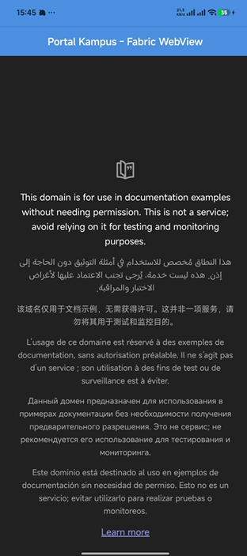

# [Nama Aplikasi]: Implementasi WebView dengan React Native

Nama: [Jaffna Naufal Safaraz]
NIM: [41155050240003]
Mata kuliah: Pemrograman Mobile (Tugas Sesi #3)
Program studi: Teknik Informatika, Universitas Langlangbuana

## Deskripsi
Aplikasi ini menampilkan halaman web di dalam aplikasi mobile menggunakan komponen WebView, sehingga pengguna dapat membuka konten web tanpa meninggalkan aplikasi. Aplikasi dibuat dengan React Native (React Native CLI) dan memuat halaman [isi alamat atau nama situs yang dimuat]. Proyek ini merupakan siklus kedua metode Prototyping, yaitu pengembangan lanjutan dari prototype awal yang dibuat dengan MIT App Inventor pada Tugas Sesi #2.

## Fitur
- Menampilkan halaman web di dalam aplikasi dengan WebView.
- [isi fitur lain bila ada, misalnya indikator loading, tombol kembali, atau tombol muat ulang]

## Teknologi
- React Native (React Native CLI)
- TypeScript
- react-native-webview

## Prasyarat
- Node.js
- Android Studio dengan emulator Android, atau HP Android dengan USB debugging aktif
- Lingkungan React Native sesuai panduan resmi: https://reactnative.dev/docs/set-up-your-environment

## Cara Menjalankan
1. Install library:
   ```sh
   npm install
   ```
2. Jalankan Metro (server pengembangan):
   ```sh
   npm start
   ```
3. Di terminal lain, jalankan aplikasi di Android:
   ```sh
   npm run android
   ```

Untuk iOS dibutuhkan macOS dan Xcode. Jalankan `bundle install` dan `bundle exec pod install`, lalu `npm run ios`.

## Cara Kerja
Komponen WebView dari `react-native-webview` dipasang di `App.tsx` dan diberi alamat halaman yang akan dimuat melalui properti `source`:

```tsx
import { WebView } from 'react-native-webview';

export default function App() {
  return <WebView source={{ uri: 'https://alamat-situs-kamu.com' }} />;
}
```

Saat aplikasi dibuka, WebView memuat halaman dari alamat tersebut dan menampilkannya memenuhi layar. [Jelaskan bagian lain dari kodemu, misalnya indikator loading atau penanganan tombol kembali.]

## Hubungan dengan Prototype Awal (Tugas Sesi #2)
Pada siklus pertama, prototype dibuat dengan MIT App Inventor. Pada siklus kedua ini, prototype dikembangkan ulang dengan React Native. Perbaikan yang dilakukan: [isi, misalnya tampilan lebih fleksibel, kode lebih mudah dikembangkan, performa lebih baik].

## Struktur File
- `App.tsx`: komponen utama yang menampilkan WebView.
- `index.js`: titik masuk aplikasi.
- `android/` dan `ios/`: proyek native untuk Android dan iOS.
- `package.json`: daftar library yang digunakan.

## Screenshot

### Tampilan aplikasi

